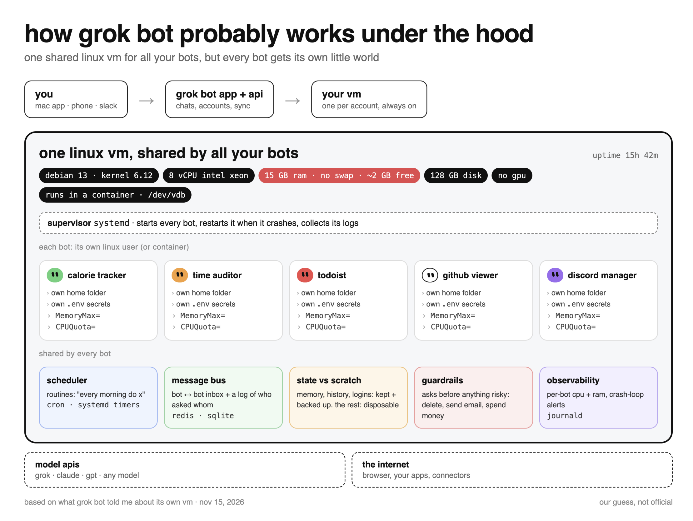

# SuperBot

An open-source, self-hosted alternative to Grok Bot.

> Not affiliated with xAI or X. "Grok" is a trademark of xAI.

You get a team of AI Bots. Each Bot has a name, a job, memory, and a real computer on your VPS. You message them like teammates. They finish work end to end and ask you only when they need approval.

## Architecture we're replicating

Our rough guess at how Grok Bot works under the hood: one shared Linux VM per account, and every Bot gets its own little world on it. Based on what a Grok Bot told us about its own VM. Not official.

Details: [VM specs](docs/background/grok-bot-computer-specs.md) and [running many Bots on one VM](docs/background/shared-vm-architecture.md).

## Harness agnostic

Bots run on the coding agent you choose:

- Claude Code CLI (first)
- Codex CLI
- Grok Build
- Hermes Agent
- Pi Agent

Each harness plugs in through one small adapter. Everything else stays the same.

## Built in Rust

We build as much as possible in Rust, for speed, low memory use, and one small binary to self-host. Web code is used only where the browser requires it.

## Features (planned)

- **Bots**: named teammates, each with its own job, chat, and memory.
- **Computer**: a persistent Linux desktop with browser, terminal, and files. Sign-ins survive between tasks.
- **Computer use**: Bots can drive the browser and GUI apps when no API exists.
- **Skills**: reusable instructions for how to do a task.
- **Routines**: run a Bot on a schedule or when something happens.
- **Approvals**: Bots pause and ask before risky actions.
- **Chat**: talk to Bots from a web app and from Slack.

## Docs

- [Grok Bot reference](docs/grok-bot-reference.md): what we are rebuilding.
- [Architecture](docs/architecture.md): the plan and open decisions.
- [Backend](docs/backend.md): how the server works, and how to run and deploy it.

## Status

Early. Chat with Bots on Claude Code, Codex, or Pi works, with memory and routines. See [Backend](docs/backend.md).

## License

MIT
